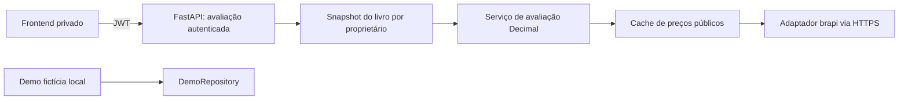

# Fase 1.9.1 — pesquisa e plano de cotações de ações brasileiras

Data da pesquisa: 27/10/2026. Escopo: somente análise e planejamento no projeto
`investment-dashboard`. Nenhuma integração, dependência, variável, migration, configuração
remota ou dado financeiro foi alterado. Não foram feitas chamadas autenticadas a provedores.

## 1. Decisão recomendada

Adotar **brapi como primeiro adaptador técnico**, com plano gratuito autenticado para avaliação
privada, cotação explicitamente atrasada e consulta exclusivamente no FastAPI. Usar HTTPX,
cache em memória e atualização sob demanda. Não adicionar Yahoo como fallback automático.

Essa escolha é por simplicidade e custo, **não é uma certificação de licenciamento ou qualidade**.
A brapi declara não integrar a cadeia licenciada de Market Data B3 e não oferecer SLA.
Sua FAQ permite exibição e cache dentro de um produto, mas restringe a entrega de feed/API
bruta concorrente. Os Termos completos não puderam ser recuperados nesta pesquisa: o link
`/terms-of-use` retornou 404. Antes de ativar em produção, conferir os termos vigentes e a
permissão para este uso privado e para o cache planejado; não transformar o backend em proxy
público. Caso seja exigida cadeia licenciada, selecionar distribuidor autorizado, sem tratar
Yahoo como solução para esse requisito.
[Declaração e condições resumidas da brapi](https://brapi.dev/faq/a-brapi-e-distribuidora-licenciada-da-b3).

Na tabela enviada pelo usuário, 1.9.1 menciona escolher e integrar. Nesta entrega prevalece
a restrição explícita de **somente analisar**: escolher agora; implementar a partir de 1.9.2.

## 2. Arquitetura e contratos inspecionados

| Área | Estado atual e consequência |
| --- | --- |
| `backend/app/models.py` | Operation possui owner_id UUID, ticker, BUY/SELL, data, quantidade, preço e taxas Numeric(20,8). Não há cadastro de instrumentos, caixa, proventos ou eventos corporativos. |
| `backend/app/main.py` | OperationInput está neste arquivo; não existe schemas.py. As operações são validadas e lidas por proprietário. GET /api/dashboard entrega o resumo; POST/DELETE validam cronologia e custo sem depender de rede externa. |
| `backend/app/finance.py` | summarize usa Decimal, ordem data/id, custo médio com taxas, baixa proporcional de custo e resultado realizado líquido de taxas de venda. market_value é None. Deve permanecer uma função contábil pura. |
| `backend/app/access.py` | private_db aplica autenticação, contexto transacional app.user_id/app.auth_mode e verificação da role. Preservar integralmente. |
| `backend/app/database.py` | Settings centraliza configuração. Não há configuração de market data. Nenhuma alteração de DATABASE_URL, roles ou RLS é necessária. |
| Dependências | HTTPX está em requirements.lock.txt, mas declarado como extra de testes no pyproject. Se usado em produção, precisa ser dependência direta de runtime, com lock coerente. |
| `frontend/src/api.ts` | Summary tipa market_value como null; valores contábeis chegam como strings decimais. request envia Bearer somente no privado. |
| `frontend/src/repositories/PrivateRepository.ts` | summary chama o backend autenticado. É o ponto de integração do novo contrato. |
| `frontend/src/App.tsx` | Card de mercado indisponível; composição por custo; gráfico é fluxo de compras menos vendas, sem taxas. Ele não representa patrimônio histórico nem rentabilidade. |
| `frontend/src/demo/finance.ts` e DemoRepository | Cálculo local com decimal.js, dados fictícios e localStorage. Devem continuar sem cotação externa. |
| Configuração Vercel | CSP privada permite Supabase e Render. Não será necessário permitir brapi/Yahoo no navegador; CSP pública continua sem conexões externas. |

Os testes existentes incluem custo médio, vendas parciais, cronologia, isolamento, autenticação,
paridade demo/Python (`shared/finance-cases.json`), HTTP privado e ausência de rede na demo.
Não há teste nem serviço de cotações atualmente.

## 3. Comparação das fontes

Valores e limites são um retrato da pesquisa e precisam ser reconfirmados antes da contratação.

| Fonte | Custo/limites observados | Atualização | Chave/cobertura | Confiabilidade, licença e manutenção |
| --- | --- | --- | --- | --- |
| brapi Gratuito | R$ 0; 15.000 chamadas/ciclo mensal, 1 ativo por chamada e 1 chamada simultânea | Aproximadamente 30 min, não tempo real | Token para ativos fora do sandbox; ITUB4/PETR4 estão entre os quatro de teste; validar BBAS3/B3SA3 com a conta real | API documentada e simples; sem SLA; condições de uso e procedência precisam ser aceitas conscientemente |
| brapi Startup/Pro | 150.000/500.000 chamadas; 10/20 ativos por chamada; 4/16 simultâneas | Cerca de 15/5 min; não prometer tick-by-tick | Token; cobertura e módulos dependem do plano | Upgrade só se a necessidade justificar; plano pago não transforma a fonte em feed B3 licenciado |
| Yahoo via yfinance | Biblioteca sem tarifa própria ou chave tradicional; não foi encontrada quota gratuita contratual garantida | Yahoo identifica cotações brasileiras como atrasadas; não fixar atraso exato não confirmado | Ex.: ITUB4.SA, BBAS3.SA, B3SA3.SA e PETR4.SA; homologar símbolo/campo individualmente | Wrapper não oficial, sujeito a bloqueios, 429 e mudanças; biblioteca livre não concede licença dos dados; manutenção e termos tornam a opção inferior para o backend publicado |
| B3 histórica / distribuidor licenciado | Arquivos históricos são um produto diferente de feed; contratação de feed/distribuição tem condições próprias, sem assumir franquia gratuita | Histórico/fim de dia ou modalidade contratada | Downloads não equivalem a uma API de último preço; credenciais dependem do serviço | Maior controle contratual no feed licenciado, com mais custo/integração; não fazer scraping do site |
| Alpha Vantage | Chave gratuita padrão: 25 chamadas/dia; exceção educacional/open-source exige verificação do fornecedor | Depende do dataset/plano; não inferir B3 em tempo real por suporte a mercados americanos | Chave obrigatória; cobertura atual dos quatro ativos brasileiros não confirmada | Não recomendado sem prova de cobertura; quota padrão pequena para atualizar quatro posições |

Fontes dos limites: [brapi limites](https://brapi.dev/faq/quais-as-limitacoes),
[brapi sandbox/gratuito](https://brapi.dev/faq/api-e-gratis-mesmo) e
[Alpha Vantage](https://www.alphavantage.co/support/).

A página de preços consultada exibia ofertas anuais equivalentes a R$ 99,99/mês Startup
(R$ 1.199,90/ano) e R$ 116,66/mês Pro (R$ 1.399,90/ano). Não interpretar essas ofertas como
mensalidade avulsa: os valores da cobrança mensal independente não ficaram confirmados.
[Preços e modalidade de cobrança](https://brapi.dev/pricing).

Para Yahoo, a própria documentação do yfinance informa que não é um produto oficial e remete
aos termos de uso pessoal dos dados; a página ITUB4.SA sinaliza cotação atrasada. Não se comprovou
SLA, quota estável ou autorização de redistribuição para este projeto. Os termos Yahoo não
puderam ser recuperados nesta sessão.
[yfinance](https://ranaroussi.github.io/yfinance/) e
[identificação de atraso Yahoo](https://finance.yahoo.com/quote/ITUB4.SA/).

A página de históricos B3 informa preços sem ajuste por proventos e restringe coleta automatizada
do site. Não planejar um coletor COTAHIST automático sem condições de acesso apropriadas.
A página de políticas distingue documentos até 31/10/2026 e novos a partir de 01/11/2026:
revalidar a versão aplicável antes de contratar, sem usar tabelas antigas como preço atual.
[Históricos B3](https://www.b3.com.br/pt_br/market-data-e-indices/servicos-de-dados/market-data/historico/mercado-a-vista/cotacoes-historicas/)
e [políticas e contratos](https://www.b3.com.br/pt_br/market-data-e-indices/servicos-de-dados/market-data/distribuidores/politica-comercial-e-contratos/).

## 4. Contrato externo a homologar em 1.9.2

A documentação principal atual apresenta `GET https://brapi.dev/api/v2/stocks/quote?symbols=ITUB4`,
autenticação em `Authorization: Bearer`, itens em `results[].data`, preço regularMarketPrice,
moeda currency e instante regularMarketTime. O envelope inclui requestedSymbol/symbol/changed.
Planejar o adaptador para v2, sem copiar exemplos antigos de `/api/quote/{ticker}` como se
o contrato fosse idêntico. Fixar fixtures e verificar OpenAPI antes de implementar o parser.
[Introdução e exemplo v2](https://brapi.dev/docs).

Homologar os quatro tickers individualmente, respeitando uma chamada por ativo no gratuito.
ITUB4/PETR4 podem iniciar a prova sem chave; BBAS3/B3SA3 exigem validar o plano autenticado.
Não há comprovação nesta etapa de respostas reais, campos completos ou direito de acesso da conta.
Há divergência entre FAQ de sandbox sem limite e página de limites que informa 20/min/IP:
adotar a regra mais restritiva, sem depender de sandbox ilimitado.

Normalização: manter os tickers locais intactos; mapear símbolos somente no adaptador. Na brapi,
usar o ticker brasileiro; no Yahoo hipotético, acrescentar `.SA` apenas na integração. A validação
atual permite mais símbolos do que apenas ações: ticker sem suporte vira unavailable, não exceção
que derruba a carteira. Não converter automaticamente fracionário, código antigo ou ativo distinto.
`changed=true` exige identificar a mudança; não reescrever a posição histórica silenciosamente.

## 5. Desenho proposto — sem implementação nesta fase

### Separação de responsabilidades

- `MarketDataProvider`: interface pequena de cotação normalizada, sem conhecer usuário/operações.
- `BrapiProvider`: HTTPX, URL fixa, autenticação secreta no backend, parser v2 e validação.
- `QuoteService`: cache, limite de concorrência, proteção de quota e degradação.
- `valuation.py`: função pura que combina posições abertas e snapshots de preços; não chama HTTP.
- Novo GET `/api/dashboard/valuation`: mesmas dependências de autorização do dashboard, retorna
  o resumo contábil e a avaliação do mesmo snapshot. Manter `/api/dashboard` atual disponível.

O endpoint consulta somente os ativos com posição positiva do usuário autenticado. Não oferecer
uma API pública de símbolos arbitrários nem enviar owner_id, JWT, operações ou quantidades à brapi.
Ler o livro com RLS na transação existente e concluir a transação de leitura antes de aguardar
HTTP externo; não segurar conexão/lock PostgreSQL por até vários segundos. Não mudar as regras
de private_db para obter essa separação. Realizar a avaliação fora da transação, sem novas leituras
dependentes de contexto que já foi encerrado.

Não chamar o provedor em import/startup, `/health`, POST/DELETE, exportação ou demo.
Falha em cotação não bloqueia operações e não torna o banco indisponível.

### Cache e controle de consumo

- Cache em memória por processo; chave `(provider, mercado, ticker, moeda, versão do contrato)`.
  Guardar somente preço/metadados públicos, nunca resumo privado ou identificadores de usuários.
- TTL inicial de 1.800 s, relógio monotônico para expiração; LRU com limite, por exemplo 256 ativos.
- Requisições simultâneas ao mesmo ativo compartilham uma busca. Semáforo de provedor com limite 1
  no gratuito; o limite é da conta, não de cada usuário. No MVP, um worker/instância.
- Reinício/cold start esvazia o cache. Vários workers/instâncias multiplicam consumo e podem exceder
  a concorrência da conta: exigir coordenação compartilhada antes de escalar. Redis não é necessário
  agora; não adicionar tabela de preços nem migration para este MVP.
- Atualização somente quando o privado pede avaliação; sem cron ou polling em background.
  React Query pode usar staleTime de 30 min e refetchInterval desativado. Refoco, refresh e botão
  manual continuam sujeitos ao cache e cooldown do servidor, sem bypass de quota.
- Negative cache inicial 60 s para ativo indisponível; nunca substituir preço bom por resposta ruim.
  401/403 externos suspendem tentativas até cooldown/revisão da configuração, não viram erro de
  autenticação do usuário. Respeitar Retry-After em 429, com limite e fallback conservador.
- Contadores de hit/miss/erro e orçamento conservador por processo, com conferência do consumo no
  painel do fornecedor. Contador em RAM reinicia e não garante quota mensal global; isso é uma
  limitação explícita, não uma proteção de faturamento distribuída.

Estimativa própria, com quatro ativos e TTL 30 min: `4 × 2 × 8 h × 22 dias = 1.408` chamadas/mês;
com acesso contínuo 24 h/30 dias, `4 × 48 × 30 = 5.760`. Vinte ativos no cenário contínuo consumiriam
28.800, acima do gratuito. Incluir margem para reinícios/falhas, compartilhar cache e medir antes
de pagar ou reduzir TTL. GET da interface não equivale necessariamente a GET no fornecedor.

### Timeout e falhas

Valores iniciais propostos, não garantias do provedor: connect 1 s, read 2 s, pool 0,5 s e
deadline global de avaliação de 8 s, incluindo fila, chamadas e parsing. No gratuito, quatro
chamadas são sequenciais; deadline pode produzir resposta parcial no primeiro acesso. Não fazer
retries na mesma solicitação inicialmente. Liberar semáforos em cancelamento/erro.

Tratar timeout, DNS/TLS, 401/403/429 externos, 5xx, JSON inválido, HTML, resposta grande, campo
ausente e ticker divergente. Aceitar preço apenas finito e positivo, moeda BRL, identidade coerente
e timestamp válido com timezone; rejeitar timestamp futuro além de tolerância pequena, por exemplo
60 s. TLS permanece verificado. Não aceitar URL arbitrária nem seguir redirect para outro host
com Authorization. Não registrar header, token ou payload privado.

Retornar HTTP 200 com metadados de indisponibilidade/partialidade quando o livro foi obtido
corretamente mas o provedor falhou. Não responder 401 ao cliente por erro 401 da brapi: o frontend
hoje encerra a sessão em 401. Erros reais de autorização do aplicativo continuam 401/403.

### Cotação atrasada, cache e fechamento são conceitos separados

Cada Quote deve carregar `ticker`, `price` (string Decimal ou null), `currency`, `provider`,
`quoted_at` (instante da cotação), `fetched_at`, `from_cache`, `is_stale` e `reason`.
Separar atraso esperado do plano, idade da cotação e tempo desde a coleta. Refazer uma consulta
que retorna o mesmo dado antigo não renova quoted_at.

Proposta conservadora inicial: mais de 75 min desde quoted_at sinaliza desatualizada; último
valor válido pode ser usado como estimativa até idade máxima de 96 h, sempre identificado.
Após o limite, preço indisponível para totais. Esses parâmetros devem ser configuráveis e
homologados: não constituem calendário oficial de negociação. Em fim de semana/feriado,
mostrar a data do último negócio e estado de mercado desconhecido, salvo confirmação explícita
do fornecedor; não afirmar mercado aberto/fechado por um simples teste de dia da semana.
Feriados prolongados podem deixar o total indisponível por segurança. Não adicionar dependência
de calendário nesta primeira versão sem necessidade comprovada.

A frequência aproximada divulgada pelo fornecedor não é garantia de idade de cada amostra;
sempre exibir o horário recebido. [Recência por plano](https://brapi.dev/faq/qual-a-frequencia).

## 6. Cálculos e semântica dos indicadores — 1.9.3

Definir para cada posição aberta: quantidade `q`, custo remanescente `C` com taxas de compra,
cotação válida `P`, custo médio `CM = C/q`. Utilizar Decimal, sem float como intermediário.
Fazer parsing JSON preservando decimais e enviar strings ao frontend; arredondar somente na
apresentação. Não arredondar CM antes de multiplicar quantidades.

| Indicador | Fórmula e significado |
| --- | --- |
| Valor de mercado da posição | `VM = q × P` |
| Patrimônio em ações a mercado | `soma(VM)` das posições abertas; não inclui caixa, CDB ou dividendos não modelados |
| Resultado não realizado | `VM − C`; valorização/desvalorização da posição ainda aberta |
| Variação sobre custo aberto | `(VM − C) / C × 100`, somente com C positivo |
| Percentual agregado sobre custo aberto | `(soma(VM) − soma(C)) / soma(C) × 100`; não média simples dos percentuais |
| Resultado realizado | Manter o atual: venda líquida de taxas menos custo médio baixado |

Exemplo fictício de teste: compra de 10 ações a R$ 20 com R$ 2 de taxas dá custo R$ 202 e CM
R$ 20,20. Venda de 4 a R$ 25 com R$ 1 de taxa dá receita líquida R$ 99, custo baixado R$ 80,80
e realizado R$ 18,20. Restam 6 ações com custo R$ 121,20. A cotação fictícia de R$ 24 dá VM
R$ 144, não realizado R$ 22,80 e variação sobre custo aberto de aproximadamente 18,81%.
A nova cotação não altera os R$ 18,20 já realizados. Não descontar taxas hipotéticas de venda.

Realizado + não realizado pode ser apresentado como resultado monetário das operações registradas,
com as exclusões claras; não é automaticamente rentabilidade total. Compras acumuladas e receitas
de vendas também não são patrimônio. Não somar vendas de novo ao valor de mercado.

Sem registro de caixa/aportes/resgates, eventos e proventos não é possível prometer retorno total,
TWR, XIRR ou comparação correta com CDI/IBOV. Em 1.9.3, o percentual deve ser rotulado
**variação sobre o custo das posições abertas**, sem anualização nem rótulo ambíguo de rentabilidade.
Retorno temporal completo fica fora deste ciclo, exigindo projeto próprio de fluxos/eventos.

Não implementar ajuste automático de splits, bonificações, JCP ou mudança de ticker. A posição
deve refletir as quantidades econômicas corretas antes de valorar; cotação atual não corrige
um livro incompleto. Não combinar fechamento ajustado histórico com quantidades/custos brutos.

### Contrato de resposta proposto

O novo endpoint devolve os campos contábeis atuais e `market_value: string | null`, mais um
objeto `valuation` opcional no tipo compartilhado, contendo resultado não realizado, percentual
sobre custo aberto, estado `complete | stale | partial | unavailable | empty`, metadados por ativo,
tickers sem preço e subtotal dos ativos cobertos. O provider não é exposto como proxy bruto.

- Todos os ativos cotados: total e percentuais disponíveis; se algum preço estiver stale,
  mostrar avaliação estimada desatualizada e o intervalo de timestamps dos ativos.
- Algum ativo sem preço utilizável: total market_value, não realizado agregado e percentual
  agregado ficam null. Exibir subtotal explicitamente parcial e custo/quantidade dos descobertos;
  nunca tratá-los como zero, usar preço de compra como cotação ou apresentar subtotal como total.
- Nenhuma posição aberta: VM e não realizado zero, percentual null, sem chamadas externas;
  realizado histórico permanece intacto.
- Demo: contrato atual permanece válido, market_value null e valuation ausente. Nenhuma busca
  privada ou cotação real é introduzida para preencher o card da demonstração.

## 7. Frontend e gráficos — 1.9.4

PrivateRepository passará a consumir o novo endpoint quando 1.9.3 estiver pronta, recebendo livro
e avaliação coerentes de um único snapshot, sem combinar saldos de duas respostas concorrentes.
Manter cache React Query separado por identidade e limpeza em troca de conta/logout.

Mostrar valor de mercado em ações, resultado não realizado, variação sobre custo aberto,
fonte/horário/atraso e estados parcial/desatualizado/indisponível. Erro de mercado não encerra
login nem oculta os dados contábeis. Permitir atualização sem contornar limites do backend.

Atualizar a composição para mercado somente quando a cobertura for completa e identificada;
oferecer custo como leitura claramente rotulada. Não trocar o significado da composição da demo.
O gráfico atual continua identificado como fluxo de operações. Uma cotação atual não permite
reconstruir patrimônio histórico: nenhum gráfico passado deve ser preenchido repetindo o preço
de hoje. Séries históricas a mercado, snapshots persistentes e ajustes corporativos ficam fora
do MVP 1.9.2–1.9.5. Não adicionar chamada à brapi no frontend nem alterar CSP para essa origem.

## 8. Arquivos previstos para próximas subfases

Nomes de arquivos novos são propostas; nenhum deles foi criado nesta análise.

| Subfase | Criar/modificar | Objetivo |
| --- | --- | --- |
| 1.9.2 | Novos `backend/app/market_data/{__init__,types,provider,brapi,cache,service}.py`; `backend/app/database.py` somente Settings; `backend/app/main.py` para lifecycle do cliente; `backend/pyproject.toml`, `backend/requirements.lock.txt` | Adaptador, cache, cliente HTTPX reutilizável e configurações |
| 1.9.2 | `backend/.env.production.example`, `.env.example`, documentação | Propor MARKET_DATA_ENABLED=false, MARKET_DATA_PROVIDER=brapi, BRAPI_API_KEY secreto, TTL/timeouts/limites; sem novos VITE_* ou valores reais |
| 1.9.3 | Novo `backend/app/valuation.py`; `backend/app/main.py`; `backend/app/finance.py` somente se uma extração pura for necessária | Endpoint autenticado e avaliação; preservar summarize usado pelas mutações |
| 1.9.4 | `frontend/src/api.ts`, `frontend/src/repositories/PrivateRepository.ts`, `frontend/src/App.tsx`, estilos pertinentes | Tipos compatíveis, consultas privadas e indicadores/gráficos honestos |
| 1.9.2–1.9.5 | Novos testes backend `test_market_data.py`, `test_valuation.py`, `test_market_data_api.py`; atualizar testes frontend e contrato HTTP | Cobrir falhas, finanças, segurança e regressão demo |
| 1.9.5 | `docs/validation.md`, documentação de publicação, eventualmente CI apenas se necessário | Evidências, smoke tests e roteiro de publicação futura |

Não previstos: migrations, alteração de Operation, RLS, roles, auth, DATABASE_URL, Docker,
fixture/seed/armazenamento da demo ou mudança dos hosts CSP. O resultado de `market_data`
não será persistido no PostgreSQL nesta fase.

## 9. Testes necessários e critérios de aceitação

1. **Adaptador com HTTPX MockTransport:** contrato v2; ITUB4/BBAS3/B3SA3/PETR4; preço decimal
   preciso; preço zero/negativo/NaN/infinito, moeda diferente, horário ausente/futuro, resposta
   parcial/vazia/HTML/grande, ticker inválido/alterado e não suportado. Token somente no header,
   nunca no JSON de resposta, URL, erro ou log. Nenhuma chamada real na CI.
2. **Cache com relógio injetado:** TTL antes/no/depois do limite; quote antigo após fetch novo;
   LRU, negative cache, reinício, quatro símbolos, deduplicação concorrente e semáforo 1;
   cancelamento, Retry-After, cooldown, orçamento e deadline global sem sleeps longos.
3. **Fallback:** timeout/DNS/TLS/5xx/429 mantém último preço bom apenas dentro do limite;
   sem cache resulta unavailable, não custo/zero; provedor 401 não vira 401 da sessão;
   fora do pregão/feriado não aparece como live. Falha externa não afeta `/health` ou mutações.
4. **Finanças:** exemplo de R$ 18,20 realizado/R$ 22,80 não realizado; ganhos/perdas, taxas,
   compras múltiplas, venda parcial/total, carteira vazia, base zero/sem percentual, preço
   fracionário e precisão. Realizado invariável ao mudar cotação. Totais completos, stale,
   parciais e indisponíveis. Sem média simples de percentuais.
5. **API e isolamento:** ausência/invalidade de JWT mantém 401, não autorizado 403; identidades
   A/B produzem apenas seus saldos. Cache público de preços pode ser compartilhado, respostas
   de carteira não. Sem acesso ao provedor antes da autenticação nem posições fechadas na busca.
   Sem chamadas durante POST/DELETE/export/health. Confirmar transação DB encerrada antes do HTTP.
6. **Frontend:** loading, complete/stale/partial/unavailable, timestamps, arredondamento BRL,
   rótulos de custo versus mercado, 401/403 existentes, mudança de conta/logout e atualização
   sob controle do servidor. Nenhum cartão interpreta null como zero ou subtotal como total.
7. **Regressão:** executar testes existentes de backend/frontend, paridade financeira, testes
   demo sem fetch/Supabase, persistência fictícia e builds demo/privado. Não exigir novos campos
   nas fixtures da demo. PostgreSQL/RLS somente em banco dedicado descartável, nunca produção.
8. **Homologação externa separada:** com chave do operador somente no backend, confirmar acesso,
   quatro símbolos, timestamps e consumo real; comparar com outra referência no mesmo instante,
   sem exigir igualdade de preços de timestamps diferentes. Não tratar mocks como validação
   de fonte, atraso, direitos de uso ou conta real. Não criar registros financeiros reais.

## 10. Sequência e gates das subfases

| Subfase | Entrega e condição de saída |
| --- | --- |
| 1.9.1 | Este documento: fonte recomendada, limitações e plano. Nenhuma integração ativada. |
| 1.9.2 | Rever termos/cobertura/contrato v2; implementar adaptador/cache sob flag inicialmente desativada. HTTPX runtime declarado e testes simulados aprovados; quota e falhas limitadas; nenhum impacto em auth, livro ou demo. |
| 1.9.3 | Criar função pura e endpoint autenticado de avaliação; exemplo financeiro e regras de partialidade aprovados; sem migration; resultado realizado e cronologia preservados. |
| 1.9.4 | Integrar somente a carteira privada; cards e composição com fonte/horário/estado, gráfico de fluxo preservado; demo idêntica e sem rede; testes e dois builds aprovados. |
| 1.9.5 | Rodar regressão, auditoria de publicação e homologação manual. Preparar rollback por flag e compatibilidade do endpoint antigo; posteriormente deploy e tag v1.9.5 somente quando autorizados explicitamente pelo usuário. Não há autorização nesta subfase para publicar/taguear. |

Para homologação/publicação futura, segredo brapi somente no Render. Configuração ausente ou
flag desligada deve manter a carteira contábil funcional, com mercado indisponível e zero HTTP
externo. `/health` continua avaliando serviço/banco, não disponibilidade da cotação. Métricas
sem tickers associados a usuários: hit/miss, latência, falhas e consumo agregado. Reverter a
ativação não deve exigir apagar dados, migrar banco ou trocar autenticação.

## 11. Limites desta análise

Confirmados por leitura local: arquitetura, fórmulas, campos e pontos de integração descritos.
Confirmados por páginas públicas: limites/preços exibidos, exemplo v2, declaração de licença/SLA
e avisos das fontes citadas. Não confirmados: contrato completo vigente da brapi, cobertura e
respostas reais da conta para todos os tickers, precisão/latência efetiva, estabilidade/SLA,
ambiente Render/Vercel atual e autorização de redistribuição de terceiros.

Somente este documento foi acrescentado. Não foram executados testes/builds de aplicação,
pois não há código alterado; os testes acima são o plano de verificação das próximas subfases.
